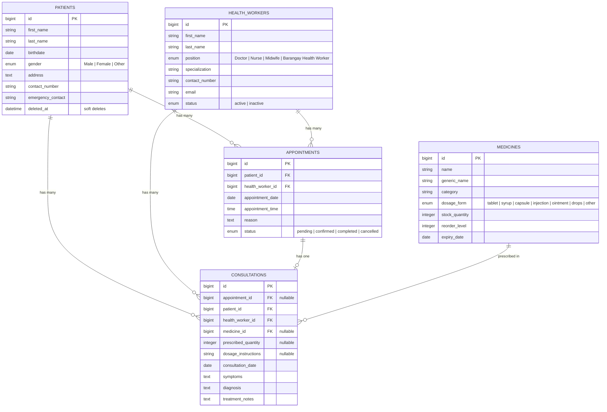

# 🏥 Community Health Center System

[](https://laravel.com)
[](https://php.net)
[](https://getbootstrap.com)
[](#-testing--quality-assurance)
[](LICENSE)

A web-based clinical management and health information system designed for community clinics, barangay health centers, and primary healthcare units. Built with **Laravel 12** and styled using **Bootstrap 5 via CDN**, following academic project requirements.

---

## 📋 Table of Contents

- [Overview](#-overview)
- [Key Features](#-key-features)
- [System Architecture & Database Schema](#-system-architecture--database-schema)
- [Tech Stack](#-tech-stack)
- [Prerequisites](#-prerequisites)
- [Installation & Setup](#-installation--setup)
- [Default Demo Credentials](#-default-demo-credentials)
- [Application Modules](#-application-modules)
- [Directory Structure](#-directory-structure)
- [Testing & Quality Assurance](#-testing--quality-assurance)
- [License](#-license)

---

## 🌟 Overview

The **Community Health Center System** eliminates paper-based bottlenecks in local health centers by providing an integrated, role-secured platform. From the moment a patient registers to medical consultations, prescription issuance, and automatic pharmacy inventory deduction, every record is tracked in real time.

---

## 🚀 Key Features

### 1. 📊 Centralized Dashboard & Real-Time Alerts
- **Key Metrics Overview**: Real-time counter cards for Total Patients, Active Health Workers, Today's Appointments, and Pending Requests.
- **Daily Appointment Feed**: Filtered schedule showing patient names, assigned doctors/health workers, and visit times.
- **Urgent Inventory Alerts**:
  - **Low Stock Warning**: Highlights medicines at or below designated reorder levels.
  - **Expiring Soon Alert**: Identifies pharmaceuticals expiring within 30 days.
  - **Expired Stock Alert**: Flags expired medicines to prevent dispensing.

### 2. 👥 Patient Registry & Medical History
- **Comprehensive Demographics**: Records patient name, date of birth, age, gender, address, contact number, and emergency contact details.
- **Search & Pagination**: Instant lookup by first or last name with persistent query pagination.
- **Unified Patient Profile**: View a patient's full clinical history, including past appointments, completed consultations, diagnoses, and prescriptions.
- **Soft-Delete Protection**: Safeguards patient records against accidental permanent data loss.

### 3. 👩‍⚕️ Health Worker Management
- **Staff Directory**: Tracks clinical personnel across positions (Doctor, Nurse, Midwife, Barangay Health Worker).
- **Specialization & Contact Tracking**: Maintains records of medical specializations, official email addresses, and phone numbers.
- **Status Toggling**: Supports `active` and `inactive` status filtering for duty scheduling.

### 4. 📅 Smart Appointment Scheduling
- **Lifecycle Tracking**: Monitor appointment status transitions (`pending` ➔ `confirmed` ➔ `completed` ➔ `cancelled`).
- **Conflict Prevention**: Built-in database unique constraints (`no_double_booking`) eliminate double-booking for the same healthcare worker at the same date and time slot.
- **Direct Consultation Handoff**: Confirmed appointments are immediately eligible for medical consultation logging.

### 5. 🩺 Consultations & Electronic Prescriptions
- **Clinical Encounter Logging**: Records symptoms, clinical diagnosis, and detailed treatment notes.
- **Flexible Workflow**: Supports consultations tied to scheduled appointments as well as walk-in visits.
- **Direct Prescription Dispensing**: Directly prescribes inventory medicines with dosage instructions (e.g., *"1 tablet 3x daily for 7 days"*).
- **Atomic Stock Deduction**: Automatically deducts dispensed quantities from pharmacy inventory within an atomic database transaction.

### 6. 💊 Pharmacy & Medicine Inventory Control
- **Medicine Catalog**: Manages brand names, generic names, therapeutic categories (e.g., Antibiotic, Analgesic, Vitamin), and dosage forms (tablet, syrup, capsule, injection, ointment, drops).
- **Real-Time Stock Tracking**: Automated stock decrementing upon prescription saving.
- **Automated Reorder Thresholds**: Customizable reorder levels per medicine with alert triggers on the dashboard.
- **Batch Expiry Monitoring**: Keeps inventory compliant with pharmaceutical safety standards.

### 7. 🛡️ Role-Based Access Control (RBAC)
- **Admin**: Full access across all modules, including record deletion and system administration.
- **Staff**: Operational clinical access (create, read, and update patients, appointments, consultations, and medicines); destructive delete operations are restricted.

---

## 🏛️ System Architecture & Database Schema

The relational database implements **exactly five (5) related domain tables**:



---

## 💻 Tech Stack

| Layer | Technology |
| :--- | :--- |
| **Backend Framework** | [Laravel 12.x](https://laravel.com) |
| **Language** | [PHP 8.2+](https://php.net) |
| **Frontend** | [Blade Templates](https://laravel.com/docs/blade) |
| **UI Framework** | [Bootstrap 5.3 via CDN](https://getbootstrap.com) |
| **Icons** | [Bootstrap Icons 1.11 via CDN](https://icons.getbootstrap.com) |
| **Authentication** | [Laravel Breeze](https://laravel.com/docs/starter-kits#laravel-breeze) |
| **Build Tool** | [Vite](https://vitejs.dev) |
| **Database** | MySQL 8.0+ (SQLite compatible for local testing) |
| **Testing** | [PHPUnit 11.x](https://phpunit.de) |

---

## ⚙️ Prerequisites

Ensure you have the following installed on your development machine:

- **PHP** >= 8.2 with extensions: `pdo`, `mbstring`, `openssl`, `tokenizer`, `xml`, `ctype`, `json`, `curl`
- **Composer** >= 2.x
- **Node.js** >= 18.x & **NPM**
- **MySQL** >= 8.0 or MariaDB >= 10.4 (or SQLite for local testing)

---

## 🛠️ Installation & Setup

Follow these steps to set up the project locally:

### 1. Clone the Repository
```bash
git clone https://github.com/amberroseperote62-cpu/Community-Health-Center-System.git
cd Community-Health-Center-System
```

### 2. Install Dependencies
```bash
# Install PHP dependencies
composer install

# Install Node.js dependencies
npm install
```

### 3. Configure the Environment
Copy the example environment file and generate a unique application key:
```bash
cp .env.example .env
php artisan key:generate
```

Configure your database connection in `.env`:
```env
DB_CONNECTION=mysql
DB_HOST=127.0.0.1
DB_PORT=3306
DB_DATABASE=community_health_center
DB_USERNAME=root
DB_PASSWORD=your_password
```
> **Note**: Ensure the database `community_health_center` is created in your MySQL server before running migrations.

### 4. Run Migrations & Seed Sample Data
Execute migrations and populate the database with realistic sample records (patients, health workers, appointments, consultations, medicines, and user accounts):
```bash
php artisan migrate --seed
```

### 5. Build Frontend Assets
For local development with hot module reloading:
```bash
npm run dev
```

Or generate a production build:
```bash
npm run build
```

### 6. Start the Local Server
```bash
php artisan serve
```

Visit the application at: **`http://127.0.0.1:8000`**

---

## 🔑 Default Demo Credentials

The database seeder automatically creates two pre-configured accounts:

| Role | Email Address | Password | Permissions |
| :--- | :--- | :--- | :--- |
| **Admin** | `admin@example.com` | `password` | Full access (Create, Read, Update, Delete across all modules) |
| **Staff** | `staff@example.com` | `password` | Operational access (Create, Read, Update; Delete restricted) |

---

## 📱 Application Modules

| Route | Method | Description | Access |
| :--- | :--- | :--- | :--- |
| `/dashboard` | `GET` | Central clinical KPIs, daily schedule, and inventory alerts | Authenticated |
| `/patients` | `GET, POST` | Patient registry, search, creation, and profile histories | Authenticated |
| `/patients/{id}` | `PUT, PATCH` | Update patient record | Authenticated |
| `/patients/{id}` | `DELETE` | Soft-delete a patient record | Admin Only |
| `/health-workers` | `GET, POST` | Healthcare worker directory and creation | Authenticated |
| `/health-workers/{id}` | `PUT, PATCH` | Update health worker profile | Authenticated |
| `/health-workers/{id}` | `DELETE` | Remove healthcare worker record | Admin Only |
| `/appointments` | `GET, POST` | Book and list appointments | Authenticated |
| `/appointments/{id}` | `PUT, PATCH` | Reschedule or update appointment status | Authenticated |
| `/appointments/{id}` | `DELETE` | Cancel / delete appointment | Admin Only |
| `/consultations` | `GET, POST` | Record medical exams, diagnoses, and prescriptions | Authenticated |
| `/consultations/{id}` | `PUT, PATCH` | Update consultation record | Authenticated |
| `/consultations/{id}` | `DELETE` | Remove consultation log | Admin Only |
| `/medicines` | `GET, POST` | Medicine catalog, stock counts, and reorder levels | Authenticated |
| `/medicines/{id}` | `PUT, PATCH` | Update medicine details or stock | Authenticated |
| `/medicines/{id}` | `DELETE` | Remove medicine item | Admin Only |
| `/profile` | `GET, PATCH, DELETE` | User account profile and security settings | Authenticated |
| **Authentication** | | | |
| `/register` | `GET, POST` | **Sign Up** — Create a new user account (name, email, password) | Guest Only |
| `/login` | `GET, POST` | Sign in with email and password | Guest Only |
| `/logout` | `POST` | Sign out and invalidate session | Authenticated |
| `/forgot-password` | `GET, POST` | Request a password-reset link via email | Guest Only |
| `/reset-password/{token}` | `GET, POST` | Reset password using the emailed token | Guest Only |
| `/verify-email` | `GET` | Email verification notice screen | Authenticated |
| `/confirm-password` | `GET, POST` | Re-confirm password before sensitive actions | Authenticated |

---

## 📂 Directory Structure

```text
community-health-center/
├── app/
│   ├── Http/
│   │   ├── Controllers/       # Resource & Dashboard Controllers
│   │   ├── Middleware/        # Admin authorization & authentication
│   │   └── Requests/          # Form request validations
│   └── Models/                # Eloquent models (Patient, Appointment, Consultation, etc.)
├── database/
│   ├── factories/             # Model factories for testing and seed data
│   ├── migrations/            # Five domain table migrations + Laravel defaults
│   └── seeders/               # DatabaseSeeder with realistic clinic sample records
├── resources/
│   ├── css/                   # Application stylesheets
│   ├── js/                    # JavaScript entry points (Vite)
│   └── views/                 # Blade UI templates (Bootstrap 5 powered)
│       ├── layouts/           # app.blade.php — shared Bootstrap layout & navigation
│       ├── patients/          # Patient CRUD views
│       ├── health-workers/    # Health Worker CRUD views
│       ├── appointments/      # Appointment CRUD views
│       ├── consultations/     # Consultation CRUD views
│       ├── medicines/         # Medicine CRUD views
│       └── dashboard.blade.php
├── routes/
│   ├── web.php                # Web routes & role-gated endpoints
│   └── auth.php               # Authentication routes (Breeze)
└── tests/
    ├── Feature/               # Feature & integration tests (CRUD, routes, relationships)
    └── Unit/                  # Unit tests
```

---

## 🧪 Testing & Quality Assurance

The project ships with **59 automated tests covering 185 assertions** across all modules:

| Test Suite | Tests | Coverage |
| :--- | :---: | :--- |
| `PatientCrudTest` | 8 | Create, read, update, soft-delete, validation, role restrictions |
| `HealthWorkerCrudTest` | 6 | Full CRUD, duplicate email prevention, role restrictions |
| `AppointmentCrudTest` | 5 | Scheduling, double-booking conflict prevention, status updates |
| `ConsultationCrudTest` | 4 | Create with medicine deduction, appointment linkage, stock restore on delete |
| `MedicineCrudTest` | 6 | Catalog, stock update, low-stock/expiry detection, role restrictions |
| `NavigationAndRoutesTest` | 3 | Guest redirect, protected routes, dashboard metrics |
| `DatabaseAndRelationshipsTest` | 2 | Migration + seeder execution, all 5 model relationships |
| `Auth/*` | 14 | Login, register, password reset, email verification, profile |
| `ProfileTest` | 5 | Profile display, update, account deletion |
| `ExampleTest (Unit)` | 1 | Baseline sanity check |

Run the full test suite:

```bash
php artisan test
```

Run a specific test class:
```bash
php artisan test --filter PatientCrudTest
```

Run migrations fresh with seed data for manual testing:
```bash
php artisan migrate:fresh --seed
```

To run code formatting checks with Laravel Pint:
```bash
./vendor/bin/pint --test
```

To automatically format code according to PSR-12 / Laravel standards:
```bash
./vendor/bin/pint
```

---

## 📄 License

This project is open-source software licensed under the [MIT License](LICENSE).